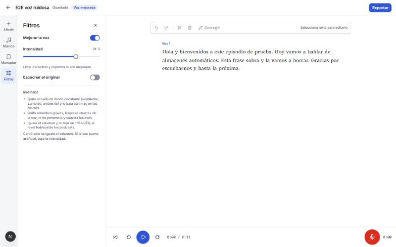

# Hitzez

**Mejora la voz y edita el audio de tus podcasts editando el texto.** Sube o graba una conversación: Hitzez quita el ruido de fondo, limpia la voz y la deja al volumen estándar de los podcasts; la transcribe en tu propio ordenador y, cuando borras una frase del texto, desaparece del audio. Luego exportas el episodio limpio en MP3 o WAV.

Todo funciona en local: el audio no sale de tu equipo, no hay cuentas ni límites de uso.



## Qué hace

- **Mejorar la voz** (panel Filtros), con intensidad ajustable de 0 a 100 y un interruptor para comparar con el original:
  - quita el ruido de fondo constante (ventilador, zumbido, ambiente) y lo baja aún más en las pausas;
  - quita retumbes graves, limpia el «barro» de la voz, le da presencia y suaviza las eses;
  - comprime y deja el volumen en **−16 LUFS** con picos por debajo de −1,5 dB, el nivel habitual de las plataformas de podcast.

  Medido con un audio de prueba con ruido y zumbido, a la intensidad por defecto (70): el ruido en las pausas baja de −39 a −50 dB, la relación voz/ruido pasa de 18 a 33,5 dB y el volumen de −20 a −16 LUFS; la transcripción del audio mejorado sale idéntica (la voz no se deforma). La exportación usa el audio mejorado.
- **Proyectos**: lista de episodios, crear y borrar.
- **Subir o grabar**: arrastra un audio o vídeo (MP3, WAV, M4A, FLAC, OGG, WebM, MP4, MOV… hasta 5 GB) o graba con el micrófono.
- **Transcripción automática** con tiempos por palabra (faster-whisper, en CPU), en español, inglés, francés, alemán, italiano o portugués. **Es opcional**: al subir o grabar puedes desmarcar «Transcribir automáticamente» (el audio se escucha, se mejora y se exporta entero, y lo transcribes más tarde con su botón **Transcribir**), y cualquier transcripción en marcha se puede **cancelar**.
- **Editar por texto**: selecciona palabras con el ratón o con Mayús + flechas y bórralas, córtalas o pégalas en otro sitio. Deshacer y rehacer ilimitados (200 pasos).
- **Corregir una palabra** mal transcrita sin tocar el audio.
- **Reproducir el episodio editado** sin huecos entre cortes, con la palabra que suena resaltada; clic en una palabra para saltar ahí.
- **Marcadores** para estructurar el episodio.
- **Guardado automático.**
- **Exportar** audio MP3 o WAV (con márgenes y fundidos cortos en cada corte para que no se oigan chasquidos) y la transcripción en TXT.

Pendiente: separar hablantes, biblioteca de música, vídeo; opcionalmente, un modelo de IA (DeepFilterNet) para ruidos difíciles no constantes (voces de fondo, tráfico), que los filtros actuales no quitan bien. El detalle está en [`replica/features.csv`](replica/features.csv) y [`replica/build-log.md`](replica/build-log.md).

## Versión para Windows (instalador)

`Hitzez-Setup-1.0.0.exe` (~650 MB) lo instala todo, sin necesitar Node, Python ni ffmpeg en el PC: se descarga desde la sección **Releases** de este repositorio.

- Se instala para tu usuario, sin permisos de administrador, en `%LOCALAPPDATA%\Programs\Hitzez`, con acceso en el menú Inicio (y en el escritorio si lo marcas).
- Al abrir **Hitzez**, se abre en el navegador en `http://127.0.0.1:3210` y queda un icono junto al reloj: **Abrir Hitzez**, **Abrir carpeta de datos**, **Ver registros** y **Salir**.
- Tus proyectos y audios se guardan en `%LOCALAPPDATA%\Hitzez`; desinstalar no los borra.
- Incluye el modelo de transcripción: funciona sin conexión a internet.
- Windows SmartScreen puede avisar de que el instalador no está firmado: «Más información» → «Ejecutar de todas formas».

Para generarlo tú (necesita Node, el entorno del worker con PyInstaller, ffmpeg, el modelo descargado e [Inno Setup 6](https://jrsoftware.org/isinfo.php)):

```powershell
worker\.venv\Scripts\python -m pip install pyinstaller
powershell -ExecutionPolicy Bypass -File packaging\build.ps1
```

Sale en `packaging\dist\Hitzez\` (carpeta portable) y `packaging\dist\setup\Hitzez-Setup-1.0.0.exe`.

## Requisitos (para desarrollar)

- Windows, macOS o Linux con **Node.js 24** y **Python 3.12 o superior**.
- **ffmpeg** y **ffprobe** en el PATH.
- ~1 GB libre para el modelo de transcripción (se descarga la primera vez).

## Instalación

```bash
git clone https://github.com/hezuradar/Podcast.git
cd Podcast

# Worker de audio (Python)
py -m venv worker/.venv                                   # macOS/Linux: python3 -m venv worker/.venv
worker/.venv/Scripts/python -m pip install -r worker/requirements.txt   # macOS/Linux: worker/.venv/bin/python

# App web
cd app
npm install
npm run dev
```

Abre http://localhost:3000. `npm run dev` arranca a la vez la web y el worker. La base de datos y los audios se guardan en `data/` (fuera de git).

Modelo de transcripción: `small` por defecto. Con `WHISPER_MODEL=base` va más rápido y es menos preciso; con `medium`, al revés.

## Cómo está hecho

```
navegador ──> Next.js 16 (interfaz + API) ──> SQLite (data/app.db) <── worker Python (ffmpeg + faster-whisper)
                                                                        └─> data/media/ (originales, audio ligero, exportaciones)
```

- `app/`: Next.js 16, React 19, Tailwind 4 con tokens de diseño, Radix UI.
- `app/src/lib/doc`: el documento de edición (las palabras transcritas no se modifican nunca; se edita una lista de referencias).
- `app/src/lib/edl`: la lista de cortes que comparten el reproductor y la exportación.
- `worker/`: cola de trabajos (`transcode`, `transcribe`, `render`).
- `replica/`: análisis, arquitectura, diseño, pruebas y decisiones del proyecto.

## Pruebas

```bash
cd app
npm test                    # 33 tests unitarios (Vitest)
npx playwright test         # 12 pruebas de punta a punta (transcripción real y opcional, cancelación, mejora de voz, grabación con micrófono simulado)
cd ..
worker/.venv/Scripts/python -m unittest discover -s worker/tests   # 13 tests del worker
```

## Origen

Proyecto personal que reconstruye, en sala limpia, la idea de editar audio a través de su transcripción. Se ha estudiado solo documentación pública del producto de referencia; no se ha usado su código, diseño, textos, logos, modelos ni contenido. Componentes de terceros: faster-whisper y modelos Whisper (MIT), ffmpeg, Radix UI (MIT), Lucide (ISC), fuentes Inter y Source Serif 4 (OFL).
