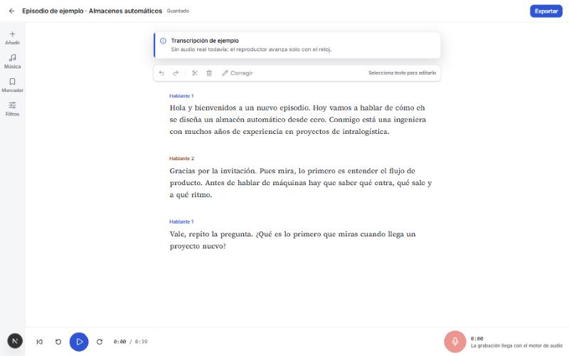

# Hitzez

**Edita el audio de tus podcasts editando el texto.** Sube o graba una conversación, Hitzez la transcribe en tu propio ordenador y, cuando borras una frase del texto, desaparece del audio. Luego exportas el episodio limpio en MP3 o WAV.

Todo funciona en local: el audio no sale de tu equipo, no hay cuentas ni límites de uso.



## Qué hace

- **Proyectos**: lista de episodios, crear y borrar.
- **Subir o grabar**: arrastra un audio o vídeo (MP3, WAV, M4A, FLAC, OGG, WebM, MP4, MOV… hasta 5 GB) o graba con el micrófono.
- **Transcripción automática** con tiempos por palabra (faster-whisper, en CPU), en español, inglés, francés, alemán, italiano o portugués.
- **Editar por texto**: selecciona palabras con el ratón o con Mayús + flechas y bórralas, córtalas o pégalas en otro sitio. Deshacer y rehacer ilimitados (200 pasos).
- **Corregir una palabra** mal transcrita sin tocar el audio.
- **Reproducir el episodio editado** sin huecos entre cortes, con la palabra que suena resaltada; clic en una palabra para saltar ahí.
- **Marcadores** para estructurar el episodio.
- **Guardado automático.**
- **Exportar** audio MP3 o WAV (con márgenes y fundidos cortos en cada corte para que no se oigan chasquidos) y la transcripción en TXT.

Pendiente: separar hablantes, mejora de voz, biblioteca de música, vídeo. El detalle está en [`replica/features.csv`](replica/features.csv) y [`replica/build-log.md`](replica/build-log.md).

## Requisitos

- Windows, macOS o Linux con **Node.js 24** y **Python 3.12 o superior**.
- **ffmpeg** y **ffprobe** en el PATH.
- ~1 GB libre para el modelo de transcripción (se descarga la primera vez).

## Instalación

```bash
git clone https://github.com/hezuradar/Podcast.git
cd Podcast

# Worker de audio (Python)
py -m venv worker/.venv                                   # macOS/Linux: python3 -m venv worker/.venv
worker/.venv/Scripts/python -m pip install -r worker/requirements.txt   # macOS/Linux: worker/.venv/bin/python

# App web
cd app
npm install
npm run dev
```

Abre http://localhost:3000. `npm run dev` arranca a la vez la web y el worker. La base de datos y los audios se guardan en `data/` (fuera de git).

Modelo de transcripción: `small` por defecto. Con `WHISPER_MODEL=base` va más rápido y es menos preciso; con `medium`, al revés.

## Cómo está hecho

```
navegador ──> Next.js 16 (interfaz + API) ──> SQLite (data/app.db) <── worker Python (ffmpeg + faster-whisper)
                                                                        └─> data/media/ (originales, audio ligero, exportaciones)
```

- `app/`: Next.js 16, React 19, Tailwind 4 con tokens de diseño, Radix UI.
- `app/src/lib/doc`: el documento de edición (las palabras transcritas no se modifican nunca; se edita una lista de referencias).
- `app/src/lib/edl`: la lista de cortes que comparten el reproductor y la exportación.
- `worker/`: cola de trabajos (`transcode`, `transcribe`, `render`).
- `replica/`: análisis, arquitectura, diseño, pruebas y decisiones del proyecto.

## Pruebas

```bash
cd app
npm test                    # 27 tests unitarios (Vitest)
npx playwright test         # 10 pruebas de punta a punta (incluye transcripción real y grabación con micrófono simulado)
cd ..
worker/.venv/Scripts/python -m unittest discover -s worker/tests   # 9 tests del worker
```

## Origen

Proyecto personal que reconstruye, en sala limpia, la idea de editar audio a través de su transcripción. Se ha estudiado solo documentación pública del producto de referencia; no se ha usado su código, diseño, textos, logos, modelos ni contenido. Componentes de terceros: faster-whisper y modelos Whisper (MIT), ffmpeg, Radix UI (MIT), Lucide (ISC), fuentes Inter y Source Serif 4 (OFL).
